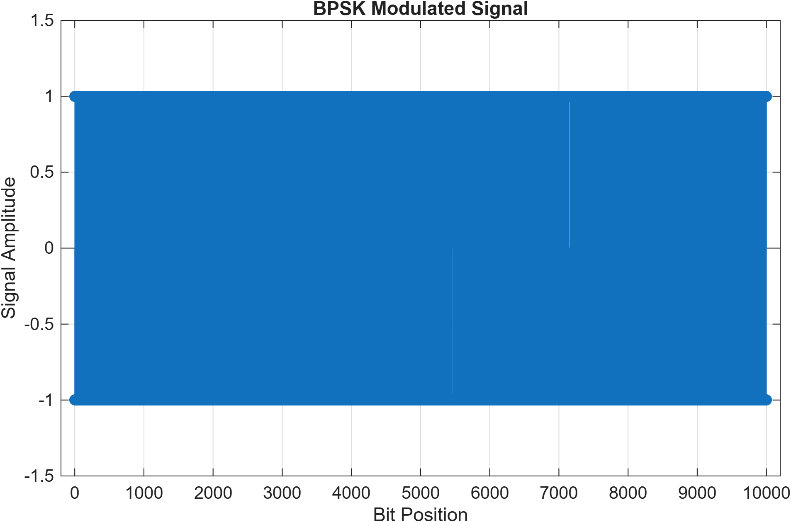
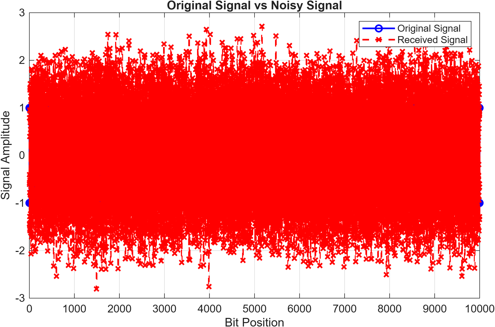
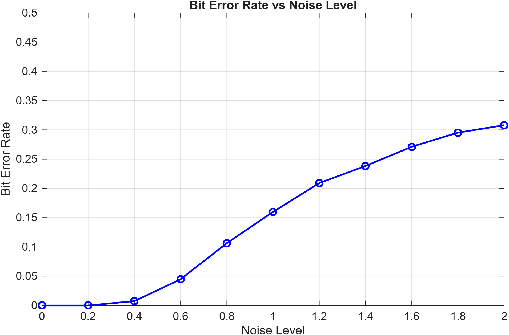

# Digital Communication System Simulator

## Overview

A MATLAB-based simulation of a digital communication system using Binary Phase Shift Keying (BPSK) modulation.

The project demonstrates how digital information can be transmitted, affected by noise, and recovered at the receiving end.

## Features

- Random binary data generation
- BPSK modulation (0 → -1, 1 → +1)
- Gaussian noise simulation
- Binary signal recovery through demodulation
- Bit Error Rate (BER) calculation
- Performance analysis across different noise levels
- Graphical visualization of transmitted and received signals

## Technologies

- MATLAB

## How It Works

1. Generate random binary data.
2. Convert binary bits into BPSK signal values.
3. Add Gaussian noise to simulate communication interference.
4. Recover the binary data using a zero-threshold detector.
5. Compare the original and recovered bits to calculate BER.
6. Repeat the experiment at different noise levels and visualize the results.

## Running the Project

1. Open MATLAB.
2. Open `digital_communication_system_simulator.m`.
3. Click **Run**.
4. View the generated graphs, BER results, and simulation summary.

## Simulation Results

### BPSK Modulated Signal

### Original vs Noisy Signal

### BER vs Noise Level

## Key Concept

The Bit Error Rate (BER) measures the proportion of transmitted bits that are incorrectly recovered.

As noise increases, the receiver is more likely to decode bits incorrectly, resulting in a higher BER.

## Author

Oladepo Olabiyi